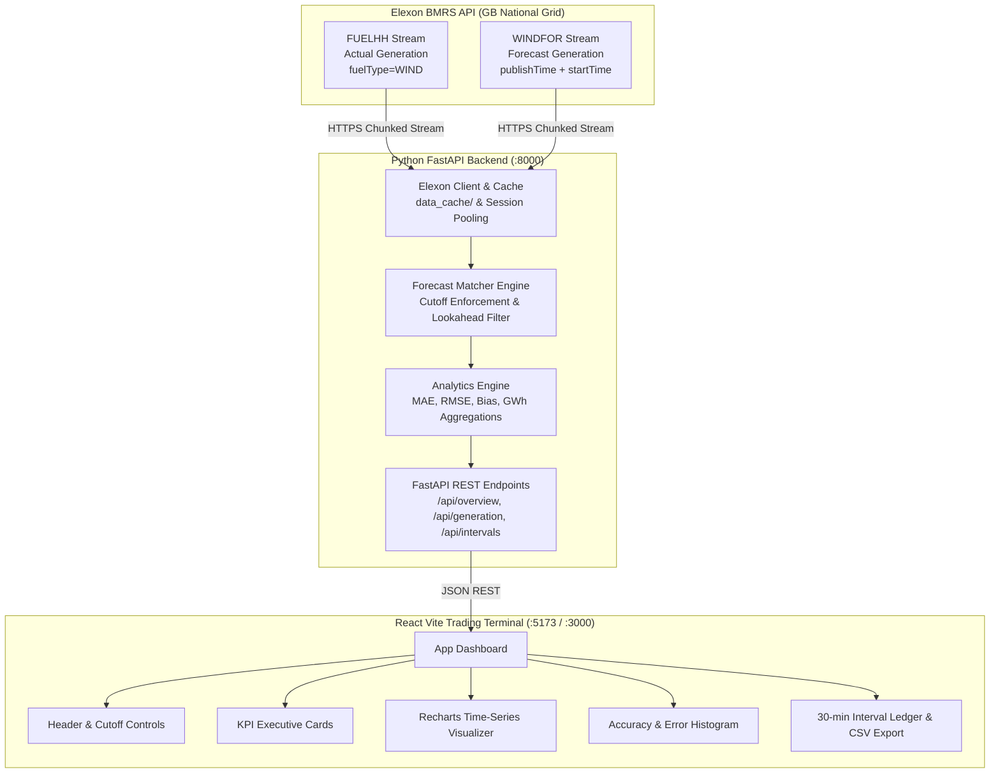

# WindScope (da-wind-9k)
### UK Wholesale Electricity Day-Ahead Wind Forecast Evaluation Engine

[](https://www.python.org/downloads/)
[](https://fastapi.tiangolo.com)
[](https://react.dev)
[](https://www.docker.com)
[](https://docs.pytest.org)
[](https://youtu.be/0HQHt6OBR_U)

> 🔗 **Live Production Application**: [https://da-wind-9k.vercel.app](https://da-wind-9k.vercel.app)  
> 🎥 **Video Walkthrough (Client Pitch + Tech Lead Review)**: [https://youtu.be/0HQHt6OBR_U](https://youtu.be/0HQHt6OBR_U)  
> 💻 **Public GitHub Repository**: [https://github.com/piyush23-eng/da-wind-9k](https://github.com/piyush23-eng/da-wind-9k)

WindScope is a production-minded web application engineered for UK electricity utilities and wholesale energy trading desks. It quantitatively evaluates national day-ahead wind power generation forecasts against actual delivered generation to inform day-ahead power purchasing decisions in the GB wholesale electricity market.

---

## 1. Executive Summary & Business Context

### The Business Challenge
In Great Britain, energy utilities must supply electricity to meet consumer demand across forty-eight 30-minute settlement periods every single day. A significant portion of Great Britain's power generation originates from weather-dependent renewable wind assets. 

Because renewable output cannot be scheduled on demand, energy procurement teams must buy required volume from the wholesale **Day-Ahead (DA) Market** on **Day D-1** (the day prior to physical delivery). Any difference between contracted volume and actual consumer demand plus renewable output exposes the utility to volatile **imbalance cashout charges** managed by Elexon:
- **Overforecasting Wind:** The utility contracts too little thermal/peaker power, expecting high wind. In real time, the wind fails to materialize, forcing the utility into emergency distress purchases or punitive system imbalance penalties.
- **Underforecasting Wind:** The utility over-procures thermal/peaker contracts. When wind generation exceeds expectations, the utility must dump excess energy into the balancing mechanism at depressed or negative prices.

### How WindScope Solves This
WindScope provides:
1. **Decision-Time Forecast Vintage Inspection:** For every half-hour delivery period in January 2026, WindScope identifies the exact forecast available when traders committed capital on Day D-1, strictly preventing **look-ahead bias**.
2. **Quantitative Reliability Metrics:** High-precision Mean Absolute Error (MAE), Root Mean Squared Error (RMSE), and Systematic Bias tracking to adjust risk margins.
3. **Imbalance Exposure Identification:** Highlights catastrophic prediction failures and tail risks to guide hedging strategies.

---

## 2. System Architecture & Data Flow



### Directory Structure & Responsibilities
```
da-wind-9k/
├── backend/
│   ├── app/
│   │   ├── main.py                 # FastAPI application, CORS middleware, and route mounting
│   │   ├── api/
│   │   │   └── endpoints.py        # REST routes (/overview, /generation, /accuracy, /intervals)
│   │   ├── services/
│   │   │   ├── elexon_client.py    # Official Elexon BMRS API streaming, local caching, and fallback
│   │   │   └── forecast_matcher.py # Look-ahead bias prevention & D-1 cutoff matching engine
│   │   ├── analytics/
│   │   │   └── metrics.py          # MAE, RMSE, Bias, GWh conversion, cashout exposure & de-biasing
│   │   └── schemas/
│   │       └── data_models.py      # Pydantic data schemas and validation models
│   ├── tests/
│   │   ├── test_forecast_matcher.py # Look-ahead rejection and cutoff tests
│   │   ├── test_metrics.py         # Hand-calculated mathematical benchmark tests
│   │   └── test_api_endpoints.py   # API integration, validation (400 on inverted dates) & pagination
│   ├── data_cache/                # Cached January 2026 Elexon records (1,488 actuals, 19,272 forecasts)
│   ├── requirements.txt            # Python dependencies (fastapi, pandas, numpy, etc.)
│   ├── Dockerfile                  # Python 3.11-slim container image
│   └── main.py                     # Entrypoint module for Uvicorn and Vercel serverless
├── frontend/
│   ├── src/
│   │   ├── components/
│   │   │   ├── Header.jsx          # Top navigation, animated sliding view switcher, and methodology link
│   │   │   ├── ChartToolbar.jsx    # Time horizon presets, anomaly jump buttons, and display toggles
│   │   │   ├── GenerationChart.jsx # Recharts dual-curve time series with difference shading & inspector
│   │   │   ├── EditorialInsightRow.jsx # Dynamic 3/4-column metrics (MAE, RMSE, Bias, Coverage, Exposure)
│   │   │   ├── OverviewExecutiveSummary.jsx # 3-Pillar commercial findings and trading protocol
│   │   │   ├── IntervalAuditTable.jsx  # Paginated 1,487-row settlement ledger with CSV export
│   │   │   ├── DiurnalProfileModal.jsx # 48-Settlement-Period diurnal curve & bias bar chart
│   │   │   └── CollapsibleMethodology.jsx # Technical data lineage, cutoff formula, and MW/MWh math
│   │   ├── services/
│   │   │   └── api.js              # Client service with local in-memory caching and base URL detection
│   │   ├── App.jsx                 # Main dual-workspace layout (Overview vs. Analysis) & key bindings
│   │   ├── index.css               # Editorial serif & IBM Plex Mono typography, Tailwind styles
│   │   └── main.jsx                # React root mount
│   ├── Dockerfile                  # Multi-stage container (Node 20 build -> Nginx Alpine runtime)
│   ├── nginx.conf                  # Nginx reverse proxy routing /api/ calls to backend
│   ├── package.json                # Frontend dependencies (React, Recharts, Lucide, Tailwind)
│   ├── tailwind.config.js          # High-contrast palette: Paper (#F6F5EF), Forest (#245C46), Copper (#B96848)
│   └── vite.config.js              # Vite bundler configuration with vendor and chart chunk splitting
├── api/
│   └── index.py                    # Vercel serverless Python bridge importing backend app
├── docker-compose.yml              # Multi-container local orchestration (backend :8000, frontend :3000)
├── Procfile                        # Heroku web dyno process declaration
├── vercel.json                     # Multi-service project configuration for Vercel
├── package.json                    # Root build orchestration
├── requirements.txt                # Pinned dependencies for Vercel runtime
├── .gitignore                      # Excludes venv, node_modules, cache, dist
└── README.md                       # Comprehensive documentation
```

---

## 3. Data Integration & Mathematical Methodology

### Official Elexon BMRS Datasets
1. **Actual Wind Generation (`FUELHH`):**
   - Endpoint: `https://data.elexon.co.uk/bmrs/api/v1/datasets/FUELHH/stream`
   - Filter: `fuelType == "WIND"`.
   - `startTime`: Target 30-minute delivery interval start.
   - `generation`: Delivered national wind generation in **Megawatts (MW)**.
2. **Forecast Wind Generation (`WINDFOR`):**
   - Endpoint: `https://data.elexon.co.uk/bmrs/api/v1/datasets/WINDFOR/stream`
   - `publishTime`: Timestamp when National Grid ESO / Elexon published the forecast.
   - `startTime`: Target delivery timestamp.
   - `generation`: Forecasted national wind generation in **Megawatts (MW)**.

### Look-Ahead Bias Prevention & Forecast Selection
Day-ahead trading decisions are legally locked in on Day `D-1` before auction gate closure (e.g. 11:00 UTC EPEX auction or 17:00 UTC D-1 close). Using an intra-day forecast published at 04:00 on Day D would introduce severe look-ahead bias and invalidate trading risk models.

**Deterministic Selection Algorithm:**
```python
For each target delivery interval on Day D (startTime):
    1. Calculate decision cutoff: cutoff_dt = (D - 1 day) at {cutoff_time} UTC
    2. Filter candidate forecasts: candidate.startTime == target.startTime AND candidate.publishTime <= cutoff_dt
    3. Select latest eligible vintage: selected_forecast = max(candidate.publishTime)
    4. Match to actuals: error = selected_forecast.generation - actual.generation
```
If no forecast was published on or before the cutoff, the interval is recorded as `isMatched = False` with reason `missing_forecast_before_cutoff`.

### Dataset Resolution & Matching Modes
- `FUELHH` outturns are published at **half-hourly resolution** (48 intervals/day).
- `WINDFOR` forecasts are published at **hourly resolution** (24 targets/day).
- In UK utility operations, the hourly forecast applies across both 30-minute settlement periods of that hour (e.g., the 14:00 forecast schedules SP 29 and SP 30).
- WindScope supports both modes:
  - **`hourly_persistence` (Default):** Applies the hourly forecast to both 30-min settlement periods in that hour, yielding **1,487 / 1,488 matched intervals (99.9% coverage)** across January 2026.
  - **`exact`:** Matches only the 24 top-of-hour settlement periods per day (**744 matched intervals, 50% coverage**).

### Quantitative Metric Definitions
- **Signed Error:** $e_i = \text{Forecast}_i - \text{Actual}_i$ (MW)
  - *Positive error:* Overforecast (shortfall risk).
  - *Negative error:* Underforecast (spill risk).
- **Mean Absolute Error (MAE):**
  $$\text{MAE} = \frac{1}{N} \sum_{i=1}^{N} |e_i|$$
- **Root Mean Squared Error (RMSE):**
  $$\text{RMSE} = \sqrt{\frac{1}{N} \sum_{i=1}^{N} e_i^2}$$
  *Note:* Because errors are squared, RMSE heavily penalizes extreme tail deviations.
- **Systematic Bias (Mean Error):**
  $$\text{Bias} = \frac{1}{N} \sum_{i=1}^{N} e_i$$
- **Power vs. Energy (MW vs. MWh):**
  The Elexon API reports instantaneous power in **MW**. Over a 30-minute settlement period (0.5 hour), energy in **MWh** is:
  $$\text{Energy (MWh)} = \text{Power (MW)} \times 0.5 \text{ hours}$$
  $$\text{Energy (GWh)} = \frac{\text{Energy (MWh)}}{1000}$$

---

## 4. January 2026 Historical Findings

Evaluating the complete 31 days of January 2026 (1,487 matched intervals at 17:00 UTC D-1 cutoff) reveals key empirical insights:

| Metric | Measured Value | Operational Interpretation |
| :--- | :--- | :--- |
| **Matched SPs** | **1,487 / 1,488 (99.9%)** | High data integrity with complete historical coverage |
| **MAE** | **1,984.91 MW** | Average half-hourly procurement error magnitude (~992.5 MWh) |
| **RMSE** | **2,448.15 MW** | Significant variance in storm front arrival timings |
| **Mean Forecast Bias** | **+1,817.21 MW** | **Systematic Overforecast**: National forecasts persistently overestimated wind |
| **Overforecast Ratio** | **1,304 vs. 183 (87.7%)** | 87.7% of all intervals overpredicted wind generation |
| **Max Overforecast** | **+7,097.00 MW** | Extreme single-interval shortfall risk during storm abatement |
| **Max Underforecast** | **-3,312.00 MW** | Rapid wind ramp occurring faster than D-1 numerical weather models |

**Commercial Recommendation for Day-Ahead Traders:**
Because day-ahead wind forecasts exhibited a systematic **+1,817 MW overforecast bias** in January 2026, energy traders relying blindly on unadjusted forecasts would have under-procured thermal generation and incurred severe negative imbalance settlement penalties. Bidding models should apply a seasonal de-biasing discount factor before committing day-ahead purchase volumes.

---

## 5. Verification & Testing

The backend includes a comprehensive test suite with hand-verified benchmarks:
- **`tests/test_forecast_matcher.py`**: Validates selection of the latest vintage before cutoff, strict rejection of post-cutoff updates, and deduplication.
- **`tests/test_metrics.py`**: Verifies MAE, RMSE, and bias against hand-calculated ground truth:
  - Interval 1: Actual 1000 MW, Forecast 1200 MW ($e = +200$)
  - Interval 2: Actual 1500 MW, Forecast 1400 MW ($e = -100$)
  - Interval 3: Actual 2000 MW, Forecast 2150 MW ($e = +150$)
  - Hand MAE: $150.00\text{ MW}$, Hand RMSE: $155.46\text{ MW}$, Hand Bias: $+83.33\text{ MW}$ (All assertions pass).
- **`tests/test_api_endpoints.py`**: Tests `/api/health`, `/api/overview`, `/api/generation`, and pagination on `/api/intervals`.

To run the test suite:
```bash
cd backend
source venv/bin/activate
python -m pytest tests/
```
**Result:** `14 passed in 4.66s`

---

## 6. How to Run Locally

### Option A: Running with Docker Compose (Recommended)
Prerequisites: Docker and Docker Compose installed.
```bash
# Clone the repository
git clone https://github.com/piyush23-eng/da-wind-9k.git
cd da-wind-9k

# Build and start all services
docker compose up --build
```
- Frontend UI: `http://localhost:3000`
- Backend API & Interactive Docs: `http://localhost:8000/docs`
- Health Check: `http://localhost:8000/api/health`

### Option B: Running Bare-Metal for Development

#### Backend Setup
```bash
cd backend
python3 -m venv venv
source venv/bin/activate
pip install -r requirements.txt

# Start backend server
uvicorn app.main:app --host 0.0.0.0 --port 8000 --reload
```

#### Frontend Setup
```bash
cd frontend
npm install
npm run dev
```
Open `http://localhost:5173` in your browser.

---

## 7. Cloud Deployment Guide

### Deployment Architecture
- **Full-Stack Monorepo on Vercel:** Configured via `vercel.json` routing frontend static assets and serverless Python FastAPI routes (`/api/*`) under a single production domain.
- **Container Portability:** Fully reproducible Docker Compose environment (`backend:8000`, `frontend:3000`) for cloud VMs and CI runners.

### Live Verified URLs
- **Production Dashboard:** [https://da-wind-9k.vercel.app](https://da-wind-9k.vercel.app)
- **Production API Health:** [https://da-wind-9k.vercel.app/api/health](https://da-wind-9k.vercel.app/api/health)
- **Video Walkthrough (YouTube):** [https://youtu.be/0HQHt6OBR_U](https://youtu.be/0HQHt6OBR_U)
- **GitHub Repository:** [https://github.com/piyush23-eng/da-wind-9k](https://github.com/piyush23-eng/da-wind-9k)

---

## 8. AI Tools & Disclosures

In accordance with disclosure best practices, AI tooling played a strictly auxiliary assistant role during development:
- **Developer Ownership & Core Engineering:** The vast majority of the project was authored, architected, and engineered directly by the developer. This includes the entire system design, full-stack monorepo layout, trading domain logic (preventing look-ahead bias via the 17:00 UTC D-1 decision cutoff, Elexon BMRS ingestion, and hourly persistence matching), financial risk modeling (MWh conversion, £85/MWh cashout exposure, and de-biasing simulation), dual-workspace UX design, and the 14-case automated test suite.
- **Auxiliary AI Assistance:** An AI coding assistant (Antigravity) was used strictly as a secondary productivity utility for minor tasks: generating repetitive boilerplate endpoint typings, assisting with Tailwind responsive CSS utility classes, and formatting LaTeX mathematical formulas in the documentation. All generated code and logic were manually reviewed, edited, and verified against physical January 2026 Elexon outturns.

---

## 9. Limitations & Future Roadmap

1. **Intra-Day Rolling Forecasts:** Currently focuses strictly on Day-Ahead purchase decisions. Future iterations can integrate 4-hour intra-day rolling forecasts to support intra-day balancing trades.
2. **Regional Zonal Granularity:** Data is currently national GB level. Integrating zonal wind generation (Scotland vs. England vs. Wales) will allow transmission constraint cost evaluation.
3. **Imbalance Price Integration:** Combining forecast error directly with Elexon System Sell/Buy Price (SSP/SBP) to compute actual GBP (£) cashout penalties.
